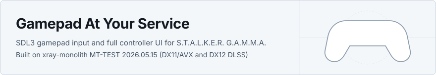

<picture>
  <source media="(prefers-color-scheme: dark)" srcset="assets/banner-en-dark.svg">
  
</picture>

  <a href="../../releases"><picture><source media="(prefers-color-scheme: dark)" srcset="assets/btn-download-en-dark.svg"></picture></a>&nbsp;
  <a href="https://github.com/oesoy1/xray-monolith-gamepad"><picture><source media="(prefers-color-scheme: dark)" srcset="assets/btn-engine-en-dark.svg"></picture></a>&nbsp;
  <a href="README.ru.md"><picture><source media="(prefers-color-scheme: dark)" srcset="assets/btn-lang-ru-dark.svg"></picture></a>

Gamepad At Your Service adds native SDL3 controller input and full gamepad UI navigation to S.T.A.L.K.E.R. G.A.M.M.A. (`xray-monolith` `MT-TEST 2026.05.15`). If you want to play the mod, grab one of the `.zip` packages on the [Releases](../../releases) page. The files in this repository are the readable UTF-8 source scripts, UI configs, and isolated C++ engine changes.

## What's in the mod

Left stick tilt sets walk and jog speed directly in any direction, and `L3` sprint lets you steer within 60 degrees without dropping out of a run. Right stick aiming has separate horizontal and vertical sensitivity, an ADS multiplier on `LT`, inner and outer deadzones, and three response curves (linear, power, S-curve). Aim assist is optional, uses engine `RayQuery` line-of-sight checks so it ignores targets behind cover, skips allies and neutrals, and turns off in scopes above 4x magnification.

Opening your backpack pauses the game. Food, meds, and `FDDA` or `Mags Redux` animations triggered on pause go into a short queue and play in order after you close the inventory (`L3` cancels the last queued item, clears trade carts, or renames a personal stash). All other G.A.M.M.A. screens have native controller navigation too: 2D and 3D PDA with `PAW` map pins, HarukaSai's Quick Action Wheel (`Hold LB`), a weapon selector fan (`Hold Y`), the four-tab workshop, technician upgrades, mutant looting, cooking, camp stoves, sleep, the 21-point card game, NPC dialogs, character creation, hideout furniture placement, companion gear, `Experience` and `HarukaSkills` menus, `BHS`, all 14 `UI_MCM` widget types, and an automatic `EN`/`RU` on-screen keyboard.

Controller settings live under `Options -> Controls -> Gamepad` across four tabs, with an 18-slot visual button remapper, five vibration sliders (recoil, hits, anomalies, weapon jams, explosions), a 19-indicator button tester, and `Dot Marks` button icons for Xbox, PlayStation, Nintendo, and Steam Deck in light, dark, or colored themes. All preferences are saved in `appdata\gamepad\profile.ltx`. Save files (`.scop` and `.scoc`) are untouched, so you can install or remove the mod mid-playthrough.

## Downloads

| Archive | Target setup | Engine files in `bin\` |
|---|---|---|
| `GAMMA-Standard.zip` | Standard S.T.A.L.K.E.R. G.A.M.M.A. (DX11 / AVX, recommended for most players) | `AnomalyDX11AVX.exe`, `AnomalyDX11.exe`, `SDL3.dll` |
| `GAMMA-DLSS-Optional.zip` | Optional G.A.M.M.A. edition with DX12 bridge (DLSS, FSR 3, Frame Generation; all-in-one, no separate DLSS mod required) | `AnomalyDX12-DLSS.exe`, `SDL3.dll`, DLSS/FSR/Streamline DLLs, DLSS menu and shader patch |

Each `.zip` imports straight into Mod Organizer 2 (`Install a new mod from an archive`). Enable the mod at the bottom of your load order, open its folder in Explorer, and run `Install_Engine.cmd` (or `Установить_движок.cmd`) to update `<Anomaly>\bin\` with an automatic backup.

## Supported controllers

| Class | Models | Verification status | Notes |
|---|---|---|---|
| Class A | Xbox Series X\|S (`045e:0b12`) | Tested in-game | Windows XInput reports `trig_rumble=0`; weapon recoil uses the main grip motors. |
| Class A | Xbox One, Elite Series 2, Xbox 360, 8BitDo (X-Input mode) | SDL3 native + offline tests | Supported by SDL3 `3.4.18` out of the box; awaiting player reports on hardware. |
| Class B | DualSense, DualShock 4, Switch Pro, Steam Deck | SDL3 native + offline tests | Turn off Steam Input and close DS4Windows on USB. Matching icon sets are in settings. |
| Class C | Generic DirectInput USB gamepads | Manual setup wizard | Can be mapped in `Options -> Controls -> Gamepad -> Other Settings -> Class C Setup Wizard`. |

## Documentation

For players:
- [Installation and 3-step uninstall](docs/en/INSTALL.md)
- [Controller button map](docs/en/CONTROLS.md)
- [FAQ](docs/en/FAQ.md) and [Known issues](docs/en/KNOWN-ISSUES.md)
- [Crash report tool](docs/en/CRASH-REPORT.md)

For modders and engine developers:
- [Developer and engine porting guide](docs/en/DEVELOPERS.md)
- [`gamedata/`](gamedata/) (Lua scripts, XML layouts, `eng`/`rus`/`ukr` string tables, `.dds` icon atlases)
- [`engine-changes/`](engine-changes/) (our standalone C++ modules, unit tests, and code patches)
- [`xray-monolith-gamepad`](https://github.com/oesoy1/xray-monolith-gamepad) (full engine tree with branches `gp-release-mt-may` and `gp-release-mt-may-dlss`)
- [Credits and licenses](docs/en/CREDITS.md) and [Changelog](CHANGELOG.md)
