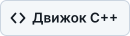

<picture>
  <source media="(prefers-color-scheme: dark)" srcset="assets/banner-ru-dark.svg">
  
</picture>

  <a href="../../releases"><picture><source media="(prefers-color-scheme: dark)" srcset="assets/btn-download-ru-dark.svg"></picture></a>&nbsp;
  <a href="https://github.com/oesoy1/xray-monolith-gamepad"><picture><source media="(prefers-color-scheme: dark)" srcset="assets/btn-engine-ru-dark.svg"></picture></a>&nbsp;
  <a href="README.md"><picture><source media="(prefers-color-scheme: dark)" srcset="assets/btn-lang-en-dark.svg"></picture></a>

Gamepad At Your Service добавляет в S.T.A.L.K.E.R. G.A.M.M.A. прямое управление с геймпада через SDL3 и переделанную под кнопки навигацию во всех окнах игры (на базе движка `xray-monolith` `MT-TEST 2026.05.15`). Готовые архивы для установки в игру лежат в разделе [Releases](https://github.com/oesoy1/Gamepad-At-Your-Service/releases). В самой папке репозитория находятся открытые исходники в кодировке UTF-8 и выделенные правки движка для чтения и переноса.

[Посмотреть геймплей на YouTube](https://www.youtube.com/watch?v=1cSvmj2MOhs)

## Что внутри мода

Наклон левого стика напрямую задаёт скорость и угол шага на 360 градусов, а во время бега (`L3`) можно подруливать в пределах 60 градусов без срыва спринта. Для правого стика настраиваются чувствительность по осям, отдельный множитель в прицеле (`LT`), внутренняя и внешняя мёртвые зоны и три кривые отклика (линейная, степенная, S-кривая). Помощь в прицеливании включается по желанию: она проверяет прямую видимость через `RayQuery` в движке (через стены и густые кусты прицел не тянет), пропускает союзников и нейтралов и отключается на оптике свыше 4x.

С геймпада можно управлять рюкзаком, обыском, торговлей и окном техника. Геймпад работает и в остальных окнах сборки: 2D и 3D КПК с метками `PAW`, колесо быстрого доступа `HarukaSai` (`Удерж. LB`), веер оружия (`Удерж. Y`), верстак на 4 вкладки, техник, разделка мутантов, полевая готовка и печки, сон, игра «21 очко», диалоги, создание персонажа, расстановка мебели в убежище, инвентарь напарников, окна навыков `Experience` и `HarukaSkills`, лечение `BHS`, все 14 видов настроек в `UI_MCM` и автоматическая экранная клавиатура (`RU`/`EN`).

Все настройки собраны в меню `Настройки -> Управление -> Геймпад` (четыре вкладки, визуальное переназначение 18 кнопок, 5 ползунков вибрации, экран проверки кнопок и значки `Dot Marks` для Xbox, PlayStation, Nintendo и Steam Deck в светлом, тёмном и цветном оформлении). Профиль хранится отдельно в `appdata\gamepad\profile.ltx`. В файлы сохранений `.scop` и `.scoc` мод ничего не записывает, поэтому его можно ставить и удалять в любой момент прохождения.

## Файлы для скачивания

| Архив | Для какой сборки | Файлы движка для папки `bin\` |
|---|---|---|
| `GAMMA-Standard.zip` | Обычная S.T.A.L.K.E.R. G.A.M.M.A. (DX11 / AVX, основной вариант) | `AnomalyDX11AVX.exe`, `AnomalyDX11.exe`, `SDL3.dll` |
| `GAMMA-DLSS-Optional.zip` | Дополнительный вариант с DX12-мостом (DLSS, FSR 3, генерация кадров; всё включено, отдельный мод на DLSS не требуется) | `AnomalyDX12-DLSS.exe`, `SDL3.dll`, библиотеки DLSS/FSR/Streamline, меню и шейдерный патч DLSS |

Каждый архив устанавливается напрямую в Mod Organizer 2 (`Install a new mod from an archive`). Включите мод в самом низу списка, откройте его папку в проводнике и запустите `Установить_движок.cmd` (или `Install_Engine.cmd`), чтобы обновить `<Anomaly>\bin\` с автоматической резервной копией.

## Какие геймпады поддерживаются

| Класс | Модели | Статус проверки | Примечание |
|---|---|---|---|
| Класс A | Xbox Series X\|S (`045e:0b12`) | Проверен в игре | Драйвер XInput в Windows отдаёт `trig_rumble=0`, поэтому отдача стрельбы идёт в основные моторы рукояток. |
| Класс A | Xbox One, Elite Series 2, Xbox 360, 8BitDo (режим X-Input) | База SDL3 + автотесты | Распознаются библиотекой SDL3 `3.4.18` сразу; ждём отзывов с реальных устройств. |
| Класс B | DualSense, DualShock 4, Switch Pro, Steam Deck | База SDL3 + автотесты | При игре по кабелю выключайте Steam Input и DS4Windows. Наборы значков выбираются в настройках. |
| Класс C | Старые и нестандартные USB-геймпады DirectInput | Ручная настройка | Настраиваются через `Настройки -> Управление -> Геймпад -> Другие настройки -> Мастер настройки`. |

## Документация

Игрокам:
- [Установка и удаление за 3 шага](docs/ru/INSTALL.md)
- [Схема кнопок по всем окнам](docs/ru/CONTROLS.md)
- [Частые вопросы](docs/ru/FAQ.md) и [Известные особенности](docs/ru/KNOWN-ISSUES.md)
- [Как собрать отчёт при вылете](docs/ru/CRASH-REPORT.md)

Разработчикам модов и движков:
- [Как устроен мод и как перенести его в свой движок](docs/ru/DEVELOPERS.md)
- [`gamedata/`](gamedata/) (скрипты Lua, разметка XML, переводы `rus`/`eng`/`ukr` и атласы значков `.dds`)
- [`engine-changes/`](engine-changes/) (отдельно собранные новые файлы C++, модульные тесты и патчи)
- [`xray-monolith-gamepad`](https://github.com/oesoy1/xray-monolith-gamepad) (полное дерево движка с ветками `gp-release-mt-may` и `gp-release-mt-may-dlss`)
- [Авторы и лицензии](docs/ru/CREDITS.md) и [Список изменений](CHANGELOG.md)
