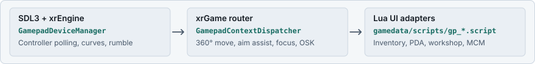

# Developer and engine porting guide

[На русском](../ru/DEVELOPERS.md) / [Back to README](../../README.md)

<picture>
  <source media="(prefers-color-scheme: dark)" srcset="../../assets/arch-en-dark.svg">
  
</picture>

This document explains how Gamepad At Your Service is structured and how to port it into another X-Ray 1.6, OpenXRay, or Anomaly `xray-monolith` fork.

## How the code is split

Device input, movement math, and frame-rate-critical state machines run in C++. Modpack screen layouts and mod hooks stay in Lua so we never have to hardcode G.A.M.M.A. addon internals into the `.exe`.

| Layer | Purpose | Main files |
|---|---|---|
| Hardware and bindings (`xrEngine`) | Opens controllers via SDL3 `3.4.18`, handles hotplug, deadzones, response curves, `Tap`/`Hold`/`DoubleTap`/`Chord` bindings (`appdata\gamepad\profile.ltx`), five rumble channels, and automatic keyboard/mouse vs. gamepad switching. Keyboard and mouse code paths stay untouched when a controller is idle. | `GamepadDeviceManager.*`, `GamepadBindings.*`, `GamepadMath.*`, `GamepadHaptics.*`, `GamepadGlyphs.*`, `Xr_input.cpp` |
| Gameplay and UI router (`xrGame`) | Tracks the active context (`World_Gameplay`, `Inventory`, `PDA`, `RadialWheel`, `MenuUI`), drives 360-degree movement (`Actor_Movement.cpp`), `RayQuery` aim assist, focus snapping, pause tokens, and the `EN`/`RU` on-screen keyboard. | `GamepadContextDispatcher.*`, `PauseTokenManager.*`, `GamepadAimAssist.*`, `UICursor.cpp`, `GamepadOnScreenKeyboard.*` |
| Lua screen adapters (`gamedata/scripts/`) | Attaches controller navigation to G.A.M.M.A. and Anomaly screens at runtime through callbacks and DXML, leaving all vanilla and modpack `.script` and `.xml` files intact on disk. | `gp_bridge.script`, `gp_inv_rework.script`, `gp_pda.script`, `gp_workshop.script`, `gp_mcm.script`, `ui_gp_native.script`, `gp_icons.script` |
| Startup check and error guard | `gp_compat.script` checks `game.get_gamepad_api_version()` at launch. If the `.exe` was overwritten by an updater and lacks our C++ exports, the Lua layer disables itself without crashing. Runtime Lua handlers run inside `gp_safe_guard.script` (`xpcall`). | `gp_compat.script`, `gp_safe_guard.script`, `gp_failover.script`, `GamepadErrorGuard.*` |

## Porting to your own engine

Our reference base is `themrdemonized/xray-monolith` commit `3d4dcca52` (`MT-TEST 2026.05.15`). All engine additions are extracted into [`engine-changes/`](../../engine-changes/).

1. Link official SDL3 (`3.4.x` x64). Download `SDL3-devel-3.4.x-VC.zip` from [`libsdl-org/SDL`](https://github.com/libsdl-org/SDL/releases), put `include/` and `lib/x64/SDL3.lib` into `src/3rd party/SDL3/`, link `SDL3.lib` in `xrEngine.vcxproj` (add `/INCLUDE:SDL_GetVersion` if whole-program optimization is on), and copy `SDL3.dll` next to your `.exe`.
2. Copy the 34 standalone files from [`engine-changes/new-files/src/`](../../engine-changes/new-files/src/) into `src/xrEngine/` and `src/xrGame/`, then add them to `xrEngine.vcxproj` and `xrGame.vcxproj`.
3. Apply [`engine-changes/patches/gamma-monolith-gamepad.patch`](../../engine-changes/patches/gamma-monolith-gamepad.patch) (`git apply --3way` or review hunks manually). Upstream edits touch five areas:
   - Input polling and window focus in `Xr_input.cpp/.h` and `Device_wndproc.cpp` (plus moving `IR_Capture()` onto the main thread in `IGame_Level.cpp` / `Level_start.cpp`).
   - Analog actor velocity, 60-degree sprint steering, and the post-UI right-stick look barrier in `ActorInput.cpp`, `Actor_Movement.cpp`, `ActorAnimation.cpp`, and `PHActorCharacter.cpp` (all gated behind `IsGamepadActiveSource()`).
   - ADS state and rumble calls in `Weapon.cpp`, `WeaponMagazined*.cpp`, `CustomZone.cpp`, and `Explosive.cpp`.
   - Focus frame, hold ring, smooth `RS` scrolling, button glyphs, and analog PDA map pan in `UICursor.cpp`, `UIButton.cpp`, `UI3tButton.cpp`, `UITrackBar.cpp`, `UIScrollView.cpp`, `UIMessageBox.cpp`, `UITalkDialogWnd.cpp`, `UIPdaWnd.cpp`, `UIMapWnd.cpp`, and `UITaskWnd.cpp`.
   - Lua exports and `gp_*` console variables in `level_script.cpp` and `console_commands.cpp`.
4. Optional DX12 bridge for DLSS, Streamline Frame Generation, and FSR 3: see [`engine-changes/patches/gamma-monolith-dlss-bridge.patch`](../../engine-changes/patches/gamma-monolith-dlss-bridge.patch) or branch `gp-release-mt-may-dlss` in [`xray-monolith-gamepad`](https://github.com/oesoy1/xray-monolith-gamepad) (adapted from `brodrigz`).
5. Build and run the 10 console unit tests in [`engine-changes/new-files/tools/tests/`](../../engine-changes/new-files/tools/tests/) to verify deadzone math, trigger parsers, focus graphs, and modal transitions in a couple of seconds without starting the game.

## Adding controller support to a custom Lua UI mod

Any unknown `CUIScriptWnd` dialog already works with the `R3` analog mouse cursor (`gp_cursor.script`).

If you want native D-Pad and stick snapping in your own addon, register your window in `gp_bridge.script` (check `gp_sys_dialogs.script` or `gp_progression.script` for short examples): return a list of widget rectangles `{ id, x, y, w, h }`, handle `A`/`B`/`X`/`Y` presses, and query button textures through `gp_icons.tex(btn, "round")` so Xbox, PlayStation, Nintendo, and Steam Deck icons switch automatically.

## Building a release archive

Files under `gamedata/` in Git are UTF-8. Running `build_release.ps1` converts `.script`, `.ltx`, and `.xml` files to `Windows-1251` without BOM and writes `SHA256SUMS.txt`:

```powershell
powershell -NoProfile -ExecutionPolicy Bypass -File tools/package/build_release.ps1 `
  -Target gamma-monolith `
  -ModSourceDir . `
  -EngineExe "path\to\AnomalyDX11AVX.exe" `
  -SdlDllPath "path\to\SDL3.dll" `
  -OutputDir ".\dist"
```
