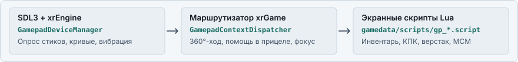

# Устройство мода и перенос в свой движок

[In English](../en/DEVELOPERS.md) / [На главную](../../README.ru.md)

<picture>
  <source media="(prefers-color-scheme: dark)" srcset="../../assets/arch-ru-dark.svg">
  
</picture>

Короткая памятка для авторов движков (форков OpenXRay, `xray-monolith`, своих сборок Anomaly и G.A.M.M.A.) и скриптовых модов: как разделён код и как перенести поддержку геймпада к себе.

## Как разделена работа между C++ и Lua

Опрос контроллера, математика стиков и чувствительные к частоте кадров узлы написаны на C++ внутри движка. Вёрстка и логика модовых окон вынесены в Lua, чтобы не зашивать внутренности аддонов G.A.M.M.A. в `.exe`.

| Уровень | За что отвечает | Основные файлы |
|---|---|---|
| Ввод и раскладки (`xrEngine`) | Работает с геймпадами через SDL3 `3.4.18`: горячее подключение, мёртвые зоны, кривые отклика, жесты `Tap`/`Hold`/`DoubleTap`/`Chord` (`appdata\gamepad\profile.ltx`), 5 каналов вибрации и автопереключение между клавиатурой/мышью и геймпадом. Когда геймпад не трогают, код клавиатуры и мыши работает как в оригинале. | `GamepadDeviceManager.*`, `GamepadBindings.*`, `GamepadMath.*`, `GamepadHaptics.*`, `GamepadGlyphs.*`, `Xr_input.cpp` |
| Мир и навигация окон (`xrGame`) | Определяет активный режим (`World_Gameplay`, `Inventory`, `PDA`, `RadialWheel`, `MenuUI`), считает 360°-движение (`Actor_Movement.cpp`), помощь в прицеле по лучу `RayQuery`, переходы рамки фокуса, токены паузы и экранную клавиатуру `RU`/`EN`. | `GamepadContextDispatcher.*`, `PauseTokenManager.*`, `GamepadAimAssist.*`, `UICursor.cpp`, `GamepadOnScreenKeyboard.*` |
| Экранные адаптеры (`gamedata/scripts/`) | Подключают управление кнопками ко всем окнам G.A.M.M.A. и Anomaly на лету через колбэки и DXML. Чужие и ванильные файлы `.script` и `.xml` на диске не перезаписываются. | `gp_bridge.script`, `gp_inv_rework.script`, `gp_pda.script`, `gp_workshop.script`, `gp_mcm.script`, `ui_gp_native.script`, `gp_icons.script` |
| Самопроверка и защита от сбоев | При запуске `gp_compat.script` сверяет `game.get_gamepad_api_version()`. Если лаунчер обновил `.exe` и в нём нет наших функций C++, скрипты отключаются без вылета. Все обработчики Lua обёрнуты в `gp_safe_guard.script` (`xpcall`). | `gp_compat.script`, `gp_safe_guard.script`, `gp_failover.script`, `GamepadErrorGuard.*` |

## Перенос в свой форк X-Ray / Anomaly за 5 шагов

За точку отсчёта взят коммит `3d4dcca52` из `themrdemonized/xray-monolith` (`MT-TEST 2026.05.15`). Все изменения со стороны движка собраны отдельно в папке [`engine-changes/`](../../engine-changes/).

1. Подключите библиотеку SDL3 (`3.4.x` x64). Скачайте `SDL3-devel-3.4.x-VC.zip` из релизов [`libsdl-org/SDL`](https://github.com/libsdl-org/SDL/releases), распакуйте `include/` и `lib/x64/SDL3.lib` в `src/3rd party/SDL3/`, пропишите `SDL3.lib` в `xrEngine.vcxproj` (при сборке с WPO добавьте `/INCLUDE:SDL_GetVersion`) и кладите `SDL3.dll` рядом с `.exe`.
2. Скопируйте 34 наших файла из [`engine-changes/new-files/src/`](../../engine-changes/new-files/src/) в `src/xrEngine/` и `src/xrGame/` и добавьте их в `xrEngine.vcxproj` и `xrGame.vcxproj`.
3. Наложите патч [`engine-changes/patches/gamma-monolith-gamepad.patch`](../../engine-changes/patches/gamma-monolith-gamepad.patch) (`git apply --3way` или вручную по блокам). В стандартном движке затронуты пять мест:
   - Опрос SDL3 рядом с DirectInput и сброс стиков/вибрации по `Alt+Tab` в `Xr_input.cpp/.h` и `Device_wndproc.cpp` (плюс вызов `IR_Capture()` в главном потоке в `IGame_Level.cpp` / `Level_start.cpp`).
   - Вектор скорости от левого стика, подруливание в спринте в пределах 60° и барьер правого стика после закрытия окон в `ActorInput.cpp`, `Actor_Movement.cpp`, `ActorAnimation.cpp` и `PHActorCharacter.cpp` (все ветки закрыты проверкой `IsGamepadActiveSource()`).
   - Состояние прицеливания и импульсы отдачи в `Weapon.cpp`, `WeaponMagazined*.cpp`, `CustomZone.cpp` и `Explosive.cpp`.
   - Рамка фокуса, кольцо удержания, попиксельная прокрутка `RS`, значки на кнопках и движение карты КПК стиком в `UICursor.cpp`, `UIButton.cpp`, `UI3tButton.cpp`, `UITrackBar.cpp`, `UIScrollView.cpp`, `UIMessageBox.cpp`, `UITalkDialogWnd.cpp`, `UIPdaWnd.cpp`, `UIMapWnd.cpp` и `UITaskWnd.cpp`.
   - Экспорты в Lua и консольные команды `gp_*` в `level_script.cpp` и `console_commands.cpp`.
4. Если вашей сборке нужен DX12-мост с DLSS, генерацией кадров Streamline и FSR 3 поверх обычного DX11-рендера, посмотрите [`engine-changes/patches/gamma-monolith-dlss-bridge.patch`](../../engine-changes/patches/gamma-monolith-dlss-bridge.patch) или ветку `gp-release-mt-may-dlss` в [`xray-monolith-gamepad`](https://github.com/oesoy1/xray-monolith-gamepad) (на основе кода `brodrigz`).
5. Соберите и запустите 10 консольных тестов из [`engine-changes/new-files/tools/tests/`](../../engine-changes/new-files/tools/tests/): они за пару секунд проверяют кривые стиков, парсер привязок, граф фокуса и стек модальных окон без запуска игры.

## Как подключить своё окно на `CUIScriptWnd`

Любое незнакомое модовое окно уже можно прокликать виртуальным курсором мыши по нажатию `R3` (`gp_cursor.script`).

Чтобы добавить переходы по крестовине и стику, зарегистрируйте окно в `gp_bridge.script` по образцу `gp_sys_dialogs.script` или `gp_progression.script`: достаточно возвращать таблицу прямоугольников `{ id, x, y, w, h }`, обрабатывать `A`/`B`/`X`/`Y` и брать иконки через `gp_icons.tex(btn, "round")` (значки Xbox, PlayStation, Nintendo и Steam Deck будут меняться сами).

## Сборка архива для игроков

В Git все текстовые файлы `gamedata/` лежат в UTF-8. Скрипт `build_release.ps1` перекодирует `.script`, `.ltx` и `.xml` в `Windows-1251` без BOM и считает контрольные суммы `SHA256SUMS.txt`:

```powershell
powershell -NoProfile -ExecutionPolicy Bypass -File tools/package/build_release.ps1 `
  -Target gamma-monolith `
  -ModSourceDir . `
  -EngineExe "path\to\AnomalyDX11AVX.exe" `
  -SdlDllPath "path\to\SDL3.dll" `
  -OutputDir ".\dist"
```
